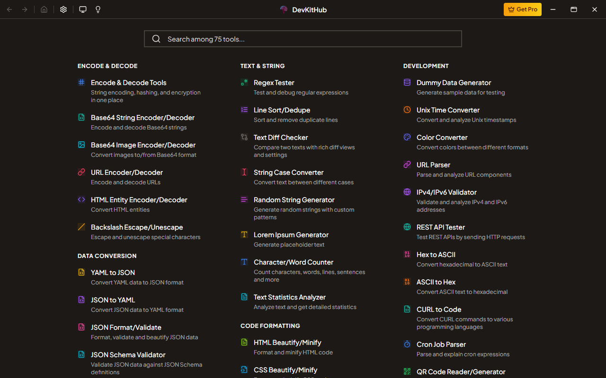

# DevKitHub

[](LICENSE)
[](https://github.com/matifanger/devkithub/stargazers)
[](https://github.com/matifanger/devkithub/releases)

**A free, open-source desktop toolkit for developers.** 75+ utilities for Windows, macOS, and Linux, in one app. No account, subscription, license activation, or API key required.

[Download](https://github.com/matifanger/devkithub/releases) · [Website](https://devkithub.com) · [Report a bug](https://github.com/matifanger/devkithub/issues) · [Contribute](CONTRIBUTING.md)



## What it does

- Formats, validates, and converts JSON, YAML, XML, TOML, SQL, HTML, CSS, JavaScript, and TypeScript.
- Encodes and decodes Base64, URLs, HTML entities, and JWTs; generates hashes, passwords, UUIDs, and sample data.
- Tests regular expressions and HTTP requests; compares text and code; previews Markdown.
- Optimizes images and provides screenshot, screen recording, video editing, and capture library tools.
- Includes clipboard history, a Kanban board, clocks, converters, local voice transcription, file renaming, and Windows maintenance tools.
- Saves preferences locally and supports themes and keyboard shortcuts.

Every tool is available for free, including tools previously offered as Pro.

## What it does not do

DevKitHub does not sell plans or require activation. Most tools process data on your device. Network tools (such as the HTTP client) contact the destination you choose; optional capture sharing uploads files only when requested. Update checks contact GitHub and can be disabled. Whisper transcription runs locally after downloading its model and runtime; it does not need a cloud API key.

It is a collection of utilities, not a replacement for an IDE, a hosted backend, antivirus, or professional data recovery software. Native features vary by platform; Windows maintenance tools are Windows-specific. Review file operations before applying them and keep backups. Availability of a build does not imply every native feature has been tested on that OS.

## Run from source

Use **Node.js 22 LTS** and npm. No `.env` file or service credentials are needed.

```sh
git clone https://github.com/matifanger/devkithub.git
cd devkithub
npm ci
npm start
```

Electron Forge rebuilds native modules for Electron. Packaging requires the native build tools for your OS (Python and a C++ toolchain, plus platform-specific package tools).

```sh
npm run test:run
npx tsc --noEmit
npm run make
```

The desktop application can run independently of the website. Optional capture sharing requires a separately configured server; local capture/export works without it. See [Capture Studio](docs/capture-studio.md), [Smart File Renamer](docs/smart-file-renamer.md), and [adding a tool](docs/add-tool-guide.md).

## Releases and history

Source code, issues, and releases now live in **`matifanger/devkithub`**. This repository was renamed from `DevKitHub-App`; its existing commits and branches are preserved. The old release repository is retired after its release assets are migrated here.

Releases before **v1.9.0** are historical commercial builds and may still display activation prompts. Use v1.9.0 or newer, or build this source, for the fully unlocked open-source edition.

## Contributing and support

Bug reports, tool ideas, documentation, and pull requests are welcome. Search [Issues](https://github.com/matifanger/devkithub/issues) first and include your OS, app version, and reproduction steps. Please do not attach secrets, private files, clipboard contents, or personal recordings.

If DevKitHub helps you, [give it a star](https://github.com/matifanger/devkithub) to help others find it.

## License

DevKitHub is released under the [MIT License](LICENSE). Dependencies, bundled media tools, models, and other third-party components retain their own licenses; see [THIRD_PARTY_NOTICES.md](THIRD_PARTY_NOTICES.md).
